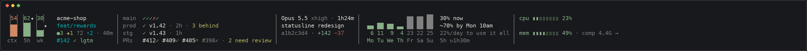

# claude-statusline

A status line for [Claude Code](https://code.claude.com) that works as a small dashboard. It shows how full your context is, how much of your usage limits you've used and where the week is heading, the state of your repo and its CI, deploys and PRs, and how hard your machine is working.



## What you need

- Claude Code
- macOS or Linux (WSL counts as Linux)
- `python3` 3.8 or later (the one that ships with macOS is fine), `git` and `bash`

## Install

```sh
git clone https://github.com/drewkhouryorg/claude-statusline.git
cd claude-statusline
./install.sh            # or ./install.sh --dry-run to see what it would change
```

Start a new Claude Code session to see it. The installer copies three files to `~/.claude/claude-statusline/` and sets `statusLine` in `~/.claude/settings.json`, after backing that file up. Your other settings are kept. If you already had a `statusLine`, it's replaced, and `./install.sh --uninstall` puts it back. If you've set `CLAUDE_CONFIG_DIR`, it installs there instead of `~/.claude`.

If it doesn't appear, run `/status` in Claude Code. Your organization's managed settings can set `statusLine` for you, and nothing in your own settings overrides them. `"disableAllHooks": true` also turns off every status line.

To upgrade, `git pull` and run `./install.sh` again. [Installing](docs/install.md) covers `--link`, setting it up by hand, and removing it.

## What works straight away, and what needs setup

Everything works as soon as it's installed, with one exception: **the ship column (CI, deploys and PRs) needs setting up in each repo.** The status line never runs code from your repo, so the repo has to write those facts to a file for it to read. The setup adds a `make info` target and has Claude Code run it after each reply. Until then, the column doesn't appear. [Setting up the ship column](docs/ship-column.md) takes about five minutes with the `gh` CLI.

The 5-hour and weekly limits show only on a Claude Pro or Max plan, because Claude Code sends them to the status line only then. A Claude apps gateway's spend limit isn't shown.

## What it shows

| Part | What it tells you |
| - | - |
| [Tanks](docs/widgets.md#tanks-context-5-hour-and-weekly-use) | How full your context is, and how much of your 5-hour and weekly limits you've used. The colour says whether your pace will run out before the reset. |
| [Repo](docs/widgets.md#repo) | The repo, branch, what's changed, time since your last commit, and this branch's PR. |
| [Ship](docs/widgets.md#ship-ci-deploys-and-prs) | The last five CI runs, each deploy and how far behind it is, and open PRs with their checks. Needs [setup](docs/ship-column.md). |
| [Session](docs/widgets.md#session) | Model, effort, how long the session has run, its name, and lines added and removed. |
| [Week](docs/widgets.md#week) | What each day of the week used, where the week will end at your pace, and how much a day you have left. |
| [System](docs/widgets.md#system-cpu-and-memory) | CPU, memory pressure and battery. Names the app to quit when memory is tight. |
| [Alerts](docs/widgets.md#alerts) | A fifth line that appears only when something needs you. |

It adapts to your terminal's width: columns when there's room, rows when there isn't ([widths](docs/widgets.md#widths)).

## Try it without Claude Code

```sh
python3 tools/preview.py                 # list the scenarios
python3 tools/preview.py bad-day         # one scenario at your terminal's width
python3 tools/preview.py healthy -w 80,120,200
python3 tools/preview.py --all           # every scenario
python3 tools/preview.py --live --watch  # this folder's git and your machine, redrawn every 2s
```

The scenarios in [`scenarios/`](scenarios) are made-up sessions, each showing one condition. [The gallery](docs/gallery.md) has a picture of each.

## Settings

Set these in the `env` block of `~/.claude/settings.json`. None are needed.

| Variable | Default | What it does |
| - | - | - |
| `CLAUDE_STATUSLINE_DAY_START` | `4` | The hour (0 to 23) a day begins in the week chart. Pick an hour when you're asleep, so no session is split across two days. |
| `CLAUDE_STATUSLINE_DATA` | `~/.claude/usage-sensor` | Where the usage files and the week log are kept. |
| `CLAUDE_STATUSLINE_SENSOR` | `1` | `0` stops writing a usage file per session. The week log is still written. |
| `CLAUDE_STATUSLINE_COLUMNS` | | How wide to draw, if `$COLUMNS` is missing or wrong in your setup. |
| `CLAUDE_STATUSLINE_PYTHON` | `python3` | Which Python the wrapper runs. |
| `CLAUDE_STATUSLINE_MAX_AGE` | `10` | Seconds the wrapper reprints its last drawing before running Python again. |

## Files it writes

- **`~/.claude/claude-statusline/`:** the three files, the `python3` the installer chose, and your earlier `statusLine` if it replaced one.
- **`~/.claude/claude-statusline/cache/`:** the last drawing for each session, and short-lived git and system readings. Files unused for a day are removed.
- **`~/.claude/usage-sensor/<session>.json`:** this session's usage, for your own hooks to read. See [usage files](docs/usage-files.md).
- **`~/.claude/usage-sensor/history.jsonl`:** the week log the chart learns from, a few KB a week.

With `CLAUDE_CONFIG_DIR` set, all of these are under that folder instead of `~/.claude`. It reads your repo's git state and `.git/project-info.json`, and never writes to either.

## What it runs in your repo

Only `git rev-parse`, `git status` and `git log`, with the two settings turned off that a repo's own config can use to make those start a program: a file monitor, and signature checking. Like any shell prompt that shows git status, `git status` still applies a repo's content filters if its config defines them, so treat a repo you don't trust as you would in your shell.

## Troubleshooting

- **It says `statusline error: ...`:** the full error is in `~/.claude/claude-statusline/error.log`. Please open an issue with it.
- **No ship column:** the repo hasn't been set up for it. See [setting up the ship column](docs/ship-column.md#when-it-doesnt-show).
- **No 5h or wk numbers:** these need a Claude Pro or Max plan, and they appear after the first reply in a session.
- **Lines are cut short, or it draws too narrow:** set `CLAUDE_STATUSLINE_COLUMNS` to your terminal's width.
- **Odd characters or misaligned columns:** your terminal font is missing a symbol. Fonts made for terminals, such as Menlo, SF Mono, JetBrains Mono or DejaVu Sans Mono, have them all.

## More

- [What each part shows](docs/widgets.md), in detail with pictures
- [Setting up the ship column](docs/ship-column.md) and [the project-info.json format](docs/project-info.md)
- [compact-nudge](https://github.com/drewkhouryorg/claude-plugins), a separate Claude Code plugin that tells you when it's a good moment to `/compact`
- [macOS and Linux](docs/platforms.md): where each reading comes from on each
- [Usage files](docs/usage-files.md): your usage numbers, written for your own hooks
- [The gallery](docs/gallery.md): a picture of every scenario
- [Testing](docs/testing.md): run the tests with `make test`

## License

MIT. See [LICENSE](LICENSE).
