# Gallery

Every scenario in [`scenarios/`](../scenarios), drawn at its own width. Run one yourself with
`python3 tools/preview.py <name>`. These pictures come from `tools/screenshots.py`, so they always match the code.

## Healthy

A normal working session: everything green, usage on pace. (120 columns.)

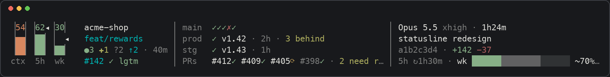

## Bad day

Everything wrong at once: ctx nearly full, 5h burning out in minutes, CI red, prod deploy failed, stale PR data, low battery, hot CPU. wk is 71% but on day 6, so pace keeps it green. (120 columns.)

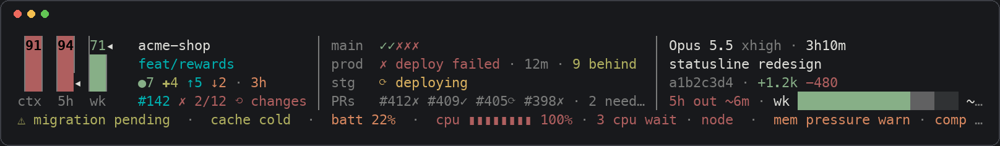

## No project

A repo that doesn't publish project-info.json: the ship column disappears, so the week chart and the system column fit at 200. (200 columns.)

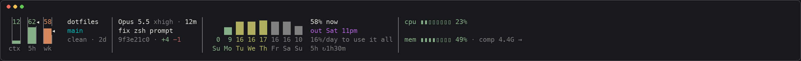

## Narrow

The healthy session in an 80-column terminal: falls back to rows. (80 columns.)

## First render

First render of a new session outside git: no context, no rate limits, no name yet. (120 columns.)

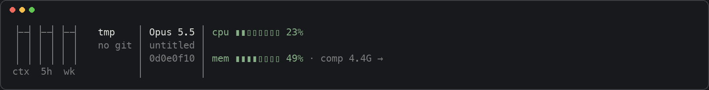

## API key

Signed in with an API key: Claude Code sends no rate limits, so the 5h and wk tanks are empty and the week chart has nothing to draw. (160 columns.)

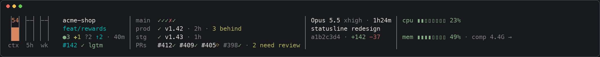

## Week running out

A heavy week: 82% used four days in. At the 7-day average it runs out before the reset, so the forecast turns purple and says when. (200 columns.)

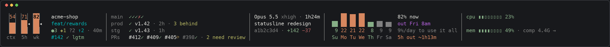

## Limits hit

Both limits hit: the 5h window is full for another 50 minutes and the week until tomorrow afternoon. (200 columns.)

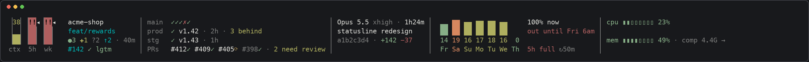

## Stale project

No Claude turn for three hours, so project-info.json hasn't been refreshed: each section dims and says how old it is. (160 columns.)

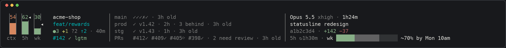

## Busy repo

A busy repo: a worktree mid-merge with conflicts, a PR with changes requested and checks still running, and seven open PRs, which collapse to counts. (160 columns.)

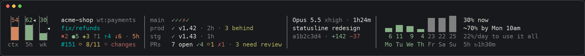

## Detached

Checked out a tag to look around: detached HEAD, a clean tree, no PR. (120 columns.)

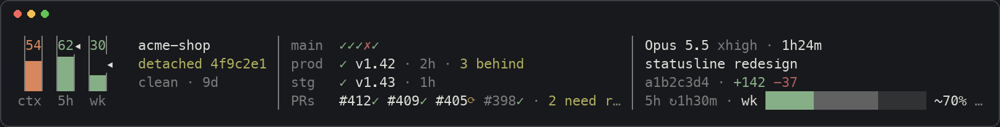

## Linux

A Linux box: no battery, no compressed memory unless zswap is on, so mem shows just how full it is. (200 columns.)

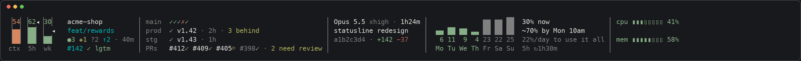

## Memory pressure

The Mac is struggling: memory pressure critical and swapping, every core busy with three tasks waiting. With room, the system column names who to blame. (240 columns.)

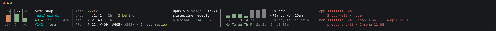

## Offline

GitHub can't be reached, so each refresh fails: the ship rows dim with their age, and the line under the columns says why. (160 columns.)

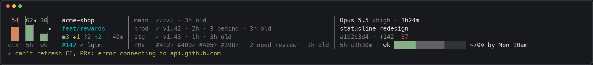

## One session at five widths

The healthy session as the terminal widens. Below 95 columns it draws rows; from there, columns are added as they fit.

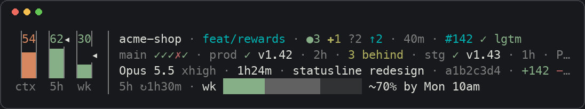

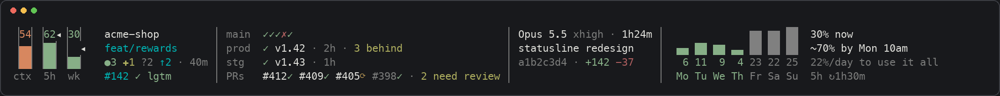

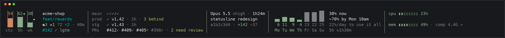

