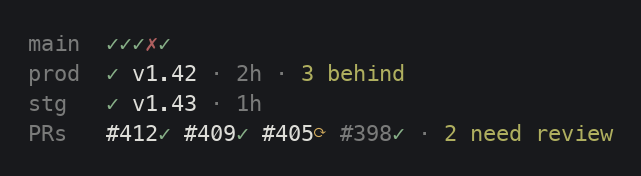

# Setting up the ship column

The ship column shows a repo's last five CI runs, its deploys and its open PRs. It's the one part of the status line that needs setting up, once in each repo.



## How it works

Your repo writes what it knows to `.git/project-info.json`, and the status line reads that file. That way no code from your repo ever runs in the status line. A `make info` target does the writing, and Claude Code hooks run it when a session starts and after each turn.

## What you need

- the [`gh` CLI](https://cli.github.com), logged in (`gh auth status` says so)
- `make`
- the status line installed with `install.sh`, which also installs the `project-info` helper the Makefile uses

## 1. Add an `info` target

Copy this into the repo's Makefile. If your main branch isn't `main`, change it in the `ci` line.

```make
# the helper install.sh put in Claude Code's config folder, quoted for paths with spaces
PI := "$(or $(CLAUDE_CONFIG_DIR),$(HOME)/.claude)/claude-statusline/project-info"
# `make info FORCE=1` refreshes everything now, however recent
REFRESH = $(PI) refresh $(if $(FORCE),--force)
BRANCH = $(shell git branch --show-current)

# Each line refreshes one section once it's older than its window: PRs and
# CI after 2 minutes, this branch's checks after 1. A failure is saved in
# the file and shown on the status line; the leading - lets the next line run.
.PHONY: info
info:
	-@$(REFRESH) prs 120 -- gh pr list --json number,isDraft,reviewDecision,statusCheckRollup \
	  --jq '$(PRS)'
	-@$(REFRESH) ci main 120 -- gh run list -b main -L 5 --json status,conclusion --jq '$(RUNS)'
	-@[ -z "$(BRANCH)" ] || $(REFRESH) branches "$(BRANCH)" 60 -- \
	  gh pr list --head "$(BRANCH)" --json statusCheckRollup --jq '$(CHECKS)'
	@$(PI) get

# The jq filters that turn gh's answers into each section. They're variables
# because a line break in a variable becomes a space on every make, while one
# inside a quoted recipe line reaches jq on GNU make and breaks it.

# A check's state as `gh pr checks` sorts it: pass, fail, pending, or skip
BUCKET = def bucket: \
  (if .__typename == "StatusContext" then .state elif .status == "COMPLETED" then .conclusion else .status end) as $$s \
  | if $$s == "SUCCESS" then "pass" \
    elif $$s == "FAILURE" or $$s == "ERROR" or $$s == "TIMED_OUT" or $$s == "ACTION_REQUIRED" \
      or $$s == "STARTUP_FAILURE" then "fail" \
    elif $$s == "SKIPPED" or $$s == "NEUTRAL" or $$s == "CANCELLED" then "skip" \
    else "pending" end;

# open PRs, newest first, each with its checks in one word
PRS = $(BUCKET) {open: length, needs_review: map(select(.reviewDecision == "REVIEW_REQUIRED")) | length, \
  items: map({number, draft: .isDraft, checks: ((.statusCheckRollup // []) | map(bucket) | map(select(. != "skip")) \
    | if length == 0 then "none" elif any(. == "fail") then "fail" elif any(. == "pending") then "pending" \
      else "pass" end)})}

RUNS = {runs: (reverse | map(if .status != "completed" then "running" \
  elif .conclusion == "success" then "ok" elif .conclusion == "cancelled" then "cancelled" \
  else "fail" end))}

# this branch's PR checks counted as `gh pr checks` counts them, or {} with no PR
CHECKS = $(BUCKET) if length == 0 then {} else {checks: (.[0].statusCheckRollup | map(bucket) \
  | {pass: map(select(. == "pass")) | length, fail: map(select(. == "fail")) | length, \
     pending: map(select(. == "pending")) | length})} end
```

Run `make info` once by hand. It should print the file with `prs`, `ci` and `branches`.

`project-info refresh` does the work on each line. It runs the `gh` command only when that section is out of date, and it makes sure several sessions don't refresh the same section at once. If `gh` fails, it keeps the old data, saves the error, and waits a full window before trying again.

## 2. Add the hooks

Add these to the repo's `.claude/settings.local.json`. That file is yours alone, so teammates who don't use this status line aren't running `make info` after every reply. If you create it by hand, add it to `.gitignore`; Claude Code only keeps it out of git when it creates the file itself:

```json
{
  "hooks": {
    "SessionStart": [{ "hooks": [{ "type": "command", "async": true,
      "command": "make -s -C \"$CLAUDE_PROJECT_DIR\" info >/dev/null 2>&1" }] }],
    "Stop": [{ "hooks": [{ "type": "command", "async": true,
      "command": "make -s -C \"$CLAUDE_PROJECT_DIR\" info >/dev/null 2>&1" }] }],
    "PostToolUse": [{ "matcher": "Bash", "hooks": [
      { "type": "command", "async": true, "if": "Bash(git push *)",
        "command": "make -s -C \"$CLAUDE_PROJECT_DIR\" info FORCE=1 >/dev/null 2>&1" },
      { "type": "command", "async": true, "if": "Bash(gh pr create *)",
        "command": "make -s -C \"$CLAUDE_PROJECT_DIR\" info FORCE=1 >/dev/null 2>&1" },
      { "type": "command", "async": true, "if": "Bash(gh pr merge *)",
        "command": "make -s -C \"$CLAUDE_PROJECT_DIR\" info FORCE=1 >/dev/null 2>&1" }
    ] }]
  }
}
```

- `SessionStart` and `Stop` keep it current as you work.
- `PostToolUse` refreshes straight away when Claude pushes, opens a PR or merges one, so you see the new CI run or PR without waiting out the window.
- `async` runs each one in the background, so Claude never waits for GitHub.

Start a new session and the column appears once the first run finishes.

## How often it runs

`SessionStart` fires when a session starts, resumes, is cleared or is compacted. `Stop` fires each time Claude finishes a reply. It doesn't fire for subagents' replies or when you interrupt with Esc. Every session in the repo runs its own hooks.

Most runs find everything fresh. Those start no `gh` command and take under half a second, in the background. Each section asks GitHub at most once per window, however many sessions are open.

These hooks run your repo's own Makefile after every reply, so only add them to a repo whose Makefile you trust. Claude Code asks you to trust a folder before it runs its project hooks.

Between your turns nothing refreshes, so a teammate's merge or a CI result shows up after your next turn. Until then, anything older than 15 minutes is dimmed and shows its age.

## Deploys

Deploys can't be looked up the same way, so a deploy target writes its result as it finishes:

```make
VERSION ?= $(shell git describe --tags --always)

deploy:
	@$(PI) set deploy prod '{"status": "running"}'
	@./scripts/deploy.sh \
	  && $(PI) set deploy prod "{\"status\": \"ok\", \"version\": \"$(VERSION)\", \"deployed_at\": $$(date +%s), \"behind\": 0}" \
	  || { $(PI) set deploy prod '{"status": "fail"}'; exit 1; }
```

## When it doesn't show

When a refresh keeps failing, the status line says so under the columns, for example `⚠ can't refresh CI, PRs: error connecting to api.github.com`. It waits until the data is out of date, so a single failed try says nothing.

If the column is missing altogether:

1. Run `make info` by hand in the repo. An error there is the reason.
2. If it mentions GitHub, run `gh auth status`.
3. If `make info` works but the column doesn't show, check the hooks are in the repo's `.claude/settings.local.json` and start a new session.
4. `"disableAllHooks": true` in any of your settings turns these hooks off, along with the status line itself.

## What it leaves in the repo

All inside `.git`, so git never commits it and every worktree shares it: `project-info.json`, a `project-info.json.lock` file used while writing it, and a `project-info.locks/` folder used while refreshing. Delete them to start over.

## Other ways to write the file

Anything can write `.git/project-info.json`: a script, a CI job, another tool. [The project-info.json format](project-info.md) has every field and the helper's commands.
