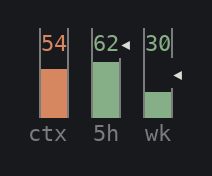
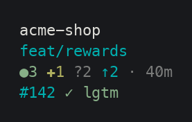
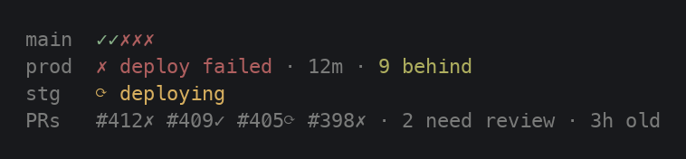
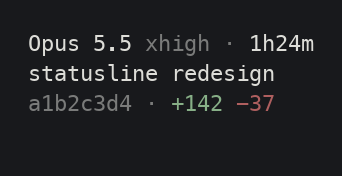
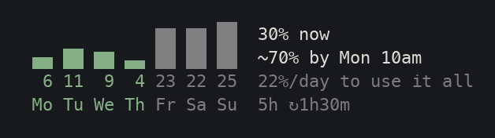
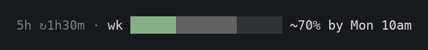
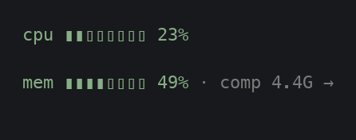
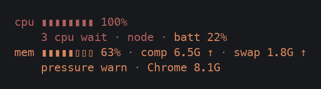
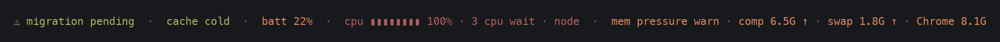

# What each part shows

The status line has up to six parts. At 240 columns they sit side by side:

From the left: [tanks](#tanks-context-5-hour-and-weekly-use), [repo](#repo), [ship](#ship-ci-deploys-and-prs), [session](#session), [week](#week) and [system](#system-cpu-and-memory), with an [alerts](#alerts) line underneath when something needs you. In a narrower terminal they stack into rows ([widths](#widths)).

## Tanks: context, 5-hour and weekly use

- `ctx` is how full the conversation's context window is.
- `5h` and `wk` are how much of your 5-hour and weekly usage limits you've used.

Each tank fills from the bottom, and its colour says how it's tracking: green, olive, orange, then red.

For the limits, the colour follows where you'll land at the reset if you keep your current pace. A heavy but sustainable day stays green. The `◂` on the right wall shows how far through the window the clock is. Fill above the marker means you're using it faster than time is passing.

The limits only show for Claude Pro and Max subscribers, because Claude Code sends them to the status line only then. With an API key, those two tanks stay empty ([see it](images/scenarios/6-api-key.png)).

## Repo

- **First row:** the repo's name, and the worktree when you're in one.
- **Second row:** the branch, or `detached` with the commit.
- **Third row:** what's changed:

  | Mark | Meaning |
  | - | - |
  | `✖` | conflicts |
  | `●` | staged |
  | `✚` | modified |
  | `?` | untracked |
  | `↑` / `↓` | ahead of / behind upstream |

  After the changes comes the time since your last commit. It turns olive after an hour and orange after three if you have uncommitted work.

- **Fourth row:** this branch's PR, if it has one: its checks and its review state.

## Ship: CI, deploys and PRs

This column shows the last five CI runs, each deploy environment with its version and how many commits it's behind, and the open PRs with their checks.

**This column needs setting up in each repo:** see [setting up the ship column](ship-column.md).

A repo that doesn't publish the file has no ship column. When the data is old, each row dims and says how old it is ([see it](images/scenarios/9-stale-project.png)). Only four rows fit. If there are more, healthy rows are hidden first, so a failure always shows.

## Session

- **First row:** the model, its effort level, and how long the session has run.
- **Second row:** the session's name.
- **Third row:** the start of the session ID, and lines added and removed.
- **Fourth row:** when the week has no chart, the [5-hour window](#the-5-hour-window) and the week as a bar.

## The 5-hour window

The 5-hour window gets one short line, beside the week chart or at the bottom of the session column:

| It says | Meaning |
| - | - |
| `5h ↻1h30m` | The window resets in 1h30m, and at your pace you won't run out first. |
| `5h out ~25m` | At your pace you'll run out in about 25 minutes, before it resets. Its colour is the 5h tank's. |
| `5h full ↻40m` | You've used all of it. It resets in 40m. |

## Week

When there's room, the week gets a chart. Each bar is what that day alone used, with the percent under it.

- **Colours:** a past day's colour compares its use against its share of the week. Days to come are grey, and they split whatever is left.
- **Words beside it:** where you are now and where the week will end at your 7-day average. When you'd run out before the reset, the forecast turns purple and says when ([see it](images/scenarios/7-week-running-out.png)).
- **Pace:** the third line says how much a day you can use from here to use it all.

Without room, the week shrinks to a bar on one line:

The chart learns from a small log it writes as you work (see [usage files](usage-files.md)), so the first time you install it, the days before then show as dots.

## System: CPU and memory

- **cpu:** how busy all the cores are. It turns orange from 70%. It goes red only when every core is busy and tasks are waiting, and then it says how many are waiting and which process is busiest.
- **mem:** how full memory is. The colour is the operating system's own memory-pressure level, which is the number to trust. `comp` is memory holding compressed pages, and `swap` shows only while pages are moving to or from disk. Under pressure, it names the app that would free the most memory if you quit it.
- **batt:** shows only on battery and under 30%.

This column only appears when everything else fits beside it. Otherwise any CPU, memory or battery alert moves to the alerts line.

## Alerts

A fifth line appears only when something needs you:

- a notice the repo published
- `⚠ can't refresh CI, PRs: ...` when the ship column's refresh keeps failing ([see it](images/scenarios/14-offline.png))
- `cache cold` when the prompt cache has expired
- CPU, memory or battery alerts that had no column to go in

## Version

The version you're running is in dim text at the right end of the bottom row. When that row is full it moves to the second row, and when neither has room it's left out.

`v0.1.0` is a release. Anything else carries the commit it came from, as in `v0.1.0+041e552`, with `*` after it when it was installed with uncommitted changes. An install from before versions shows nothing until you run `./install.sh` again.

## Widths

The same session at 80, 120, 160 and 240 columns:

Below 95 columns it switches to rows. Columns are added in order as they fit: the week chart first, then the system column. Text that still doesn't fit ends in `…`.
